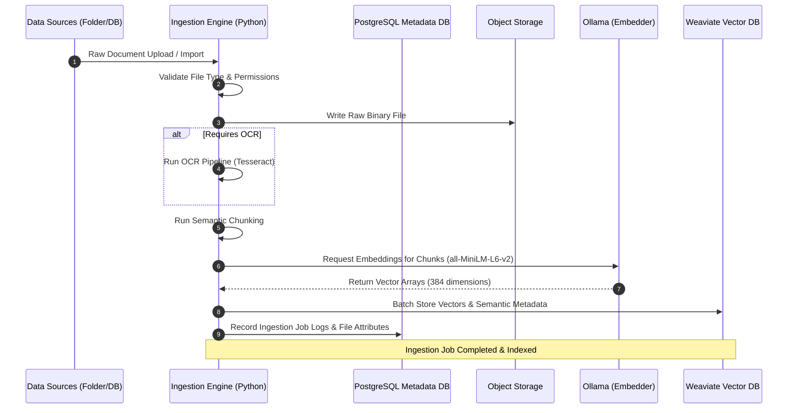
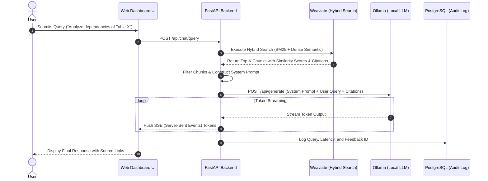
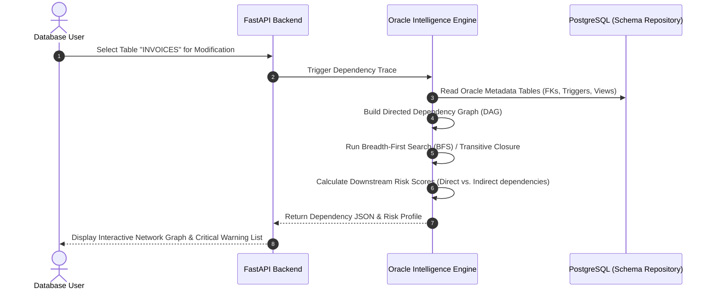

# System Architecture Document
## Project: FinXSystems Knowledge Intelligence Platform (FKIP)

---

## 1. Architectural Overview

The FinXSystems Knowledge Intelligence Platform (FKIP) uses a **Layered Service-Oriented Architecture** built on-premise. The system decouples data ingestion, storage, vector indexing, AI intelligence processing, and user presentation layers. This allows components to scale independently and ensures strict local data boundary control.

```
+---------------------------------------------------------------------------------+
|                                 APPLICATION LAYER                               |
|   +------------------+   +------------------+   +-------------+   +---------+   |
|   |  Web Dashboard   |   |  Chat Interface  |   |  API Portal |   | Reports |   |
|   +--------+---------+   +--------+---------+   +------+------+   +----+----+   |
+------------|----------------------|--------------------|---------------|--------+
             v                      v                    v               v
+------------+----------------------+--------------------+---------------+--------+
|                                INTELLIGENCE ENGINE                              |
|   +------------------+   +------------------+   +-------------+   +---------+   |
|   |   RAG Engine     |   | AI Knowledge Asst|   | Oracle Intel|   | Core Banking App |   |
|   +--------+---------+   +--------+---------+   +------+------+   +----+----+   |
|            |                      |                    |               |        |
|            +----------------------+--------------------+---------------+        |
|                                   | (Retrieval & Execution)                     |
|                                   v                                             |
|   +-------------------------------------------------------------------------+   |
|   |                       Innovation Discovery Engine                       |   |
|   +-------------------------------------------------------------------------+   |
+-----------------------------------|---------------------------------------------+
                                    v
+-----------------------------------+---------------------------------------------+
|                             VECTOR & SEARCH LAYER                               |
|                  +-------------------------------------+                        |
|                  |     Hybrid Search & Ranking Engine   |                        |
|                  +------------------+------------------+                        |
|                                     |                                           |
|                                     v                                           |
|                  +-------------------------------------+                        |
|                  |          Weaviate Vector DB         |                        |
|                  +-------------------------------------+                        |
+-------------------------------------|-------------------------------------------+
                                      v
+-------------------------------------+-------------------------------------------+
|                              KNOWLEDGE REPOSITORY                               |
|                  +-------------------------------------+                        |
|                  |     PostgreSQL Metadata Database    |                        |
|                  +-------------------------------------+                        |
|                  |     Object Store (FileSystem / MinIO)|                        |
|                  +-------------------------------------+                        |
+-------------------------------------^-------------------------------------------+
                                      |
+-------------------------------------|-------------------------------------------+
|                               INGESTION LAYER                                   |
|   +------------------+   +------------------+   +-------------+   +---------+   |
|   |  File Ingestor   |   |   OCR Pipeline   |   | Metadata Ext|   | Chunking|   |
|   +------------------+   +------------------+   +-------------+   +---------+   |
+-------------------------------------^-------------------------------------------+
                                      | (Reads)
+-------------------------------------|-------------------------------------------+
|                                DATA SOURCES                                     |
|   +------------------+   +------------------+   +-------------+   +---------+   |
|   | Documents / Files|   | Oracle Metadata  |   | Core Banking App Specs|   | Workflows|   |
|   +------------------+   +------------------+   +-------------+   +---------+   |
+---------------------------------------------------------------------------------+
```

---

## 2. Architectural Layers

### 2.1 Ingestion Layer
*   **Purpose**: Gathers unstructured and structured data and prepares it for storage and vectorization.
*   **Components**:
    *   **File Ingestor**: Connects to network shares and folders to load PDFs, DOCX, and TXT files.
    *   **OCR Pipeline**: Uses `Tesseract OCR` or `EasyOCR` to convert screenshots, process layouts, and images into raw text.
    *   **Metadata Extractor**: Leverages regular expressions and heuristics to pull creation dates, authors, version identifiers, and security tags.
    *   **Chunker**: Splits large documents into overlapping fragments (default: 500-1000 characters, 10% overlap) using recursive character-splitting models.
    *   **Data Validator**: Enforces schema rules on Core Banking applications and Oracle schema imports before saving them.

### 2.2 Knowledge Repository (KR)
*   **Purpose**: Serves as the persistent storage layer for structured application metadata, system state, and raw binary objects.
*   **Components**:
    *   **PostgreSQL**: Stores relational tables for users, permissions, Core Banking application catalogs, Oracle DB metadata (schemas, dependencies, impact weights), processing logs, and generated innovation opportunities.
    *   **Object Store**: Manages raw files, text extracts, and attachments on the local filesystem.

### 2.3 Vector & Search Layer (VSL)
*   **Purpose**: Indexes document chunks and application descriptions for fast semantic and keyword search.
*   **Components**:
    *   **Weaviate Vector DB**: An on-premise vector store that maps textual chunks to multi-dimensional coordinate spaces using dense vectors.
    *   **Hybrid Search Engine**: Merges BM25 lexical keyword scores with dense vector cosine similarity scores, producing a ranked list of relevant chunks based on configurable weights:
        $$\text{Hybrid Score} = \alpha \times \text{Semantic Score} + (1 - \alpha) \times \text{BM25 Score}$$
        *(Where $\alpha$ defaults to $0.5$)*.

### 2.4 Intelligence Engine (IE)
*   **Purpose**: Contains the core logic for reasoning, summarizing, mapping relationships, and discovering innovation opportunities.
*   **Components**:
    *   **RAG Orchestrator**: Manages context collection, assembly, prompt construction, and LLM query tasks.
    *   **AI Knowledge Assistant**: Provides conversational interaction.
    *   **Oracle Dependency Mapper**: Evaluates structural metadata extracted from Oracle to calculate dependency trees and identify downstream impact vectors.
    *   **Core Banking App Intelligence & Innovation Discovery Engine**: Groups Core Banking applications based on embedding similarities, identifies gaps in functionality, and processes ideas through the Innovation Discovery Canvas.

### 2.5 Application Layer
*   **Purpose**: Handles user authentication, session state, visualization rendering, and exports.
*   **Components**:
    *   **Web Dashboard (React / Vite)**: Built with modern, responsive components for chatting, reviewing dependency trees, and inspecting backlog pipelines.
    *   **FastAPI Backend**: Serves REST APIs, coordinates background ingestion tasks, and routes LLM calls to Ollama.

---

## 3. Data Flow Diagrams

### 3.1 Document Ingestion and Vectorization Flow
The following sequence illustrates how raw documents are loaded, split, vectorized, and indexed.



### 3.2 RAG Chat Query Flow
This sequence maps the data path when a user submits a natural language question.



### 3.3 Oracle Metadata Impact Analysis Flow
This diagram details how DB schemas are processed, mapped, and queried for impact evaluation.



---

## 4. Key Technology Stack

| Layer | Technology | Version | Purpose / Detail |
| :--- | :--- | :--- | :--- |
| **Frontend** | HTML5, JavaScript (React / Vite) | Latest | Modern SPA, vanilla CSS variables, interactive chart canvas. |
| **Backend API** | Python / FastAPI | 3.11 / Latest | High-performance asynchronous API router and background scheduler. |
| **Vector Database** | Weaviate | 1.24+ | Local containerized deployment, HNSW indexing, BM25 config. |
| **Relational Database** | PostgreSQL | 15+ | Relational schema tracker, users, logs, backlog storage. |
| **LLM Inference Engine** | Ollama | Latest | On-premise runtime for Llama-3-8B / Mistral-7B models. |
| **Embeddings Model** | SentenceTransformers | `all-MiniLM-L6-v2` | 384-dimension vector embeddings running locally. |
| **Containerization** | Docker / Docker Compose | Latest | Standardized deployment definitions for local and target instances. |

---

## 5. Security Architecture

1.  **Network Isolation**: All containers run in a bridged Docker network. Only the Frontend (port `80`) and Backend API (port `8000`) expose ports to the corporate intranet. Ollama, PostgreSQL, and Weaviate remain inaccessible from external machines.
2.  **Authentication**: JWT-based authentication tokens. Access tokens expire in 1 hour and must be renewed using secure HTTP-only cookies.
3.  **Role-Based Access Control (RBAC)**:
    *   `Admin`: Full configuration, database resets, model re-allocations, ingestion schedules.
    *   `Creator`: Read-write access to Core Banking applications, Oracle mappings, and backlog items. Can upload documents.
    *   `Consumer`: Read-only access to search engines, chat, graphs, and the Product Register.
4.  **Audit Logs**: Trigger mechanisms in PostgreSQL record query patterns, metadata changes, and downloads.

---

## 6. Private Cloud / Docker Deployment Layout

The system is deployed using `docker-compose`. Below is the planned services layout:

*   **`fkip-frontend`**: Serves pre-built static files via Nginx. Listens on port `80` (or `443` with local certificates).
*   **`fkip-backend`**: FastAPI application server. Listens on port `8000`. Runs background workers for document ingestion and text extraction.
*   **`fkip-postgres`**: PostgreSQL database container. Exposes port `5432` only within the internal bridge network. Persists data to a Docker volume.
*   **`fkip-weaviate`**: Vector Database container. Exposes port `8080` internally. Relies on local persistence volumes for schema indices.
*   **`fkip-ollama`**: Runs local model inference. Configured to mount a host GPU using the `nvidia-container-toolkit` configuration to accelerate vector generation and chat token output.
